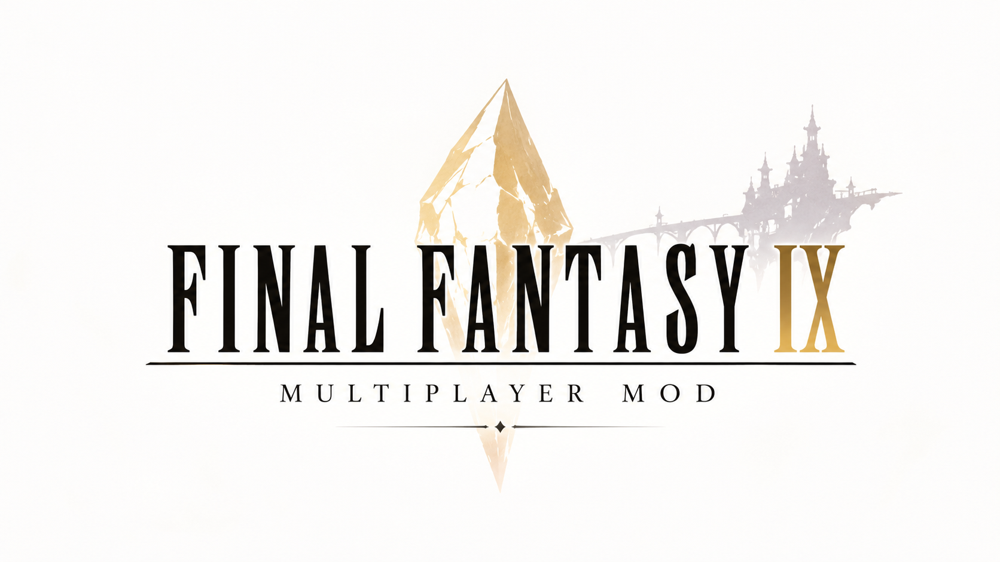

  

<h1 align="center">FF9 Coop</h1>

Koop-Multiplayer-Mod für <b>Final Fantasy IX (Steam)</b> auf Basis von <a href="https://github.com/Albeoris/Memoria">Memoria</a>. Kompatibel mit Moguri Mod.

<a href="README.md">English version</a>

Erlebt die Story gemeinsam: Jeder Party-Charakter gehört einem Spieler, der zweite Spieler läuft als sichtbarer Begleiter mit, und alles lässt sich in einem Menü im Spiel zuweisen. Gespielt wird lokal mit mehreren Controllern oder online über Steam Remote Play Together bzw. Parsec. Nur der Host braucht das Spiel und die Mods.

## Steuerung
| Aktion | Controller | Tastatur |
|---|---|---|
| Zug anfordern (Kampf, eigener Charakter ist bereit) | **Y** / Dreieck | **T** |
| Leader übernehmen (Feld/Weltkarte ohne Cutscene, nur der Nicht-Leader) | **Back/Select oder L2 + R2 1 s halten** | **L 1 s halten** |
| Begleiter: NPC ansprechen, Truhe/Schild/Auslöser benutzen, Shop | **A** | Bestätigen-Taste des Spiels |
| Begleiter auf der Weltkarte: Ort betreten (Plätze tauschen, du wirst Leader) | **A** auf dem Ort | Bestätigen-Taste des Spiels |
| Begleiter: Tetra Master herausfordern | **X** (Quadrat) | Spezial-Taste des Spiels |
| Koop-Menü öffnen/schließen (alle Zuweisungen; das Spiel pausiert) | **L3 + R3** (beide Sticks drücken) | **K** |

Im Koop-Menü stellst du ein:
- Sprache (Auto richtet sich nach der Spielsprache, English, Deutsch)
- Spieleranzahl, Leader und wer Menüs bedienen darf
- was in Solo-Abschnitten passiert (fragen, Leader bleibt, fester Spieler)
- welcher Spieler die Tastatur und welcher jeden Controller benutzt. Ein ● zeigt, welcher Controller gerade gedrückt wird.
- welcher Spieler im Kampf welchen Charakter steuert, dazu Kampfoptionen (ATB-Pause, Bereit-Vibration, P1/P2-Markierung)
- den Begleiter: an/aus, Weltkarte, welcher Charakter, farbige Spieler-Hände

Änderungen wirken sofort. „Speichern und schließen“ schreibt sie in die `FF9Coop.ini`, „Abbrechen“ (B/Esc) verwirft sie.

Tasten und Haltedauer lassen sich in `FF9Coop.ini` ändern (`TurnRequestKey`, `LeaderKey`, `LeaderHoldSeconds`, `MenuKey`).

## Installation
1. [Memoria](https://github.com/Albeoris/Memoria) installieren (oder Moguri Mod, das Memoria enthält).
2. `FF9Coop-x.y.z.zip` aus den [Releases](../../releases) in den FF9-Spielordner entpacken (es entsteht der Ordner `FF9Coop`).
3. Im Memoria-Launcher unter Mods „FF9 Coop“ aktivieren, oder in `Memoria.ini` unter `[Mod]` `FF9Coop` bei `FolderNames` vorne eintragen.

Die Sprache stellst du im Koop-Menü unter „Language / Sprache“ ein oder in der `FF9Coop.ini` mit `Language = German`.

## Läuft die Mod?
- Oben links erscheint `Koop · P1`.
- In `Memoria.log` im Spielordner stehen Zeilen mit `[FF9Coop]`, darunter `Initialization complete`. Fehler stehen dort ebenfalls.
- Ist nur ein Controller angeschlossen, darf dieser auch die Charaktere der anderen Spieler steuern.

## Fehlerbehebung
- **Das Spiel startet nicht, Steam meldet „Anwendungssteuerungsrichtlinie hat diese Datei blockiert“:** Windows Smart App Control blockiert den nicht signierten Memoria-Launcher. Abhilfe schafft nur, Smart App Control abzuschalten (Windows-Sicherheit → App- & Browsersteuerung).
- **Die Mod ist inaktiv, und im Log steht „The last start crashed while patching“:** Lösch `FF9Coop\FF9Coop.patching` im Spielordner und starte neu.
- **Nach einem Memoria-Update:** nach einer neuen Version dieser Mod schauen.

## Bekannte Einschränkungen
- PlayStation- und Switch-Controller (über JoyShockLibrary) mischt Memoria in jeden XInput-Slot. Sie lassen sich noch nicht einem einzelnen Spieler zuordnen. Xbox-Controller und die virtuellen Pads von Steam Remote Play Together funktionieren.
- Ist die Tastatur gesperrt, gelten auch Memoria-Hotkeys darüber als gesperrt (`GateKeyboard = 0` schaltet die Sperre ab).

Versionsverlauf und Anleitung zum Selbstbauen: siehe [README.md](README.md).
