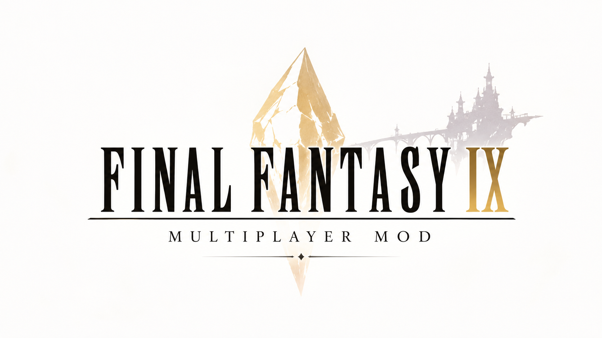

<p align="center">
  
</p>

<h1 align="center">FF9 Coop</h1>

<p align="center">Co-op multiplayer mod for <b>Final Fantasy IX (Steam)</b>, built on <a href="https://github.com/Albeoris/Memoria">Memoria</a>. Compatible with Moguri Mod.</p>

<p align="center"><a href="README.de.md">Deutsche Version</a></p>

Play the story together: every party member belongs to a player, the second player walks around as a visible companion, and everything can be assigned in an in-game menu. Play locally with several controllers or online via Steam Remote Play Together / Parsec. Only the host needs the game and the mods.

## Controls
| Action | Controller | Keyboard |
|---|---|---|
| Turn request (battle, one of your characters is ready) | **Y** / Triangle | **T** |
| Take over as leader (field/world map outside cutscenes, non-leader only) | **hold Back/Select 1 s** | **hold L 1 s** |
| Companion: talk to NPC, use chest/sign/trigger, shop | **A** | the game's confirm key |
| Companion: challenge to Tetra Master | **X** (Square) | the game's special key |
| Open/close co-op menu (all assignments; the game pauses) | **L3 + R3** (press both sticks) | **K** |

In the co-op menu you set:
- language (Auto follows the game language, English, Deutsch)
- number of players, leader and who may use menus
- what happens in solo story sections (ask, keep leader, fixed player)
- which player uses the keyboard and each controller. A ● shows which controller is currently being pressed.
- which player controls which character in battle, plus battle options (ATB pause, ready vibration, P1/P2 markers)
- the companion: on/off, world map, which character, coloured player hands

Changes take effect immediately. "Save and close" writes them to `FF9Coop.ini`, "Cancel" (B/Esc) discards them.

Keys and hold duration can be changed in `FF9Coop.ini` (`TurnRequestKey`, `LeaderKey`, `LeaderHoldSeconds`, `MenuKey`).

## Installation
1. Install [Memoria](https://github.com/Albeoris/Memoria) (or Moguri Mod, which includes it).
2. Extract `FF9Coop-x.y.z.zip` from the [releases](../../releases) into the FF9 game folder (this creates the folder `FF9Coop`).
3. Enable "FF9 Coop" in the Memoria launcher's mod manager, or add `FF9Coop` to the front of `FolderNames` under `[Mod]` in `Memoria.ini`.

## Changelog (beta)
- **v0.9.0:** English translation, German as second language (menu option "Language / Sprache")
- **v0.8.0:** Coloured "I'm here" hand with player number above every character (menu: Player hand)
- **v0.7.0:**
  - Companion collides with NPCs
  - Companion sinks into forests and water on the world map
  - Solo sections as a fixed menu option
  - Battle: ATB pause while choosing, ready signal, P1/P2 markers
  - More characters selectable as companion
- **v0.6.0:**
  - Companion on the world map (on foot only)
  - "Who plays …?" window in solo sections
  - Vibration goes to the active player's controller
- **v0.5.0:** The companion talks to NPCs, opens chests, shops and plays Tetra Master. Whoever starts a conversation also controls it.
- **v0.4.0:** Co-op menu in FF9 style (K / L3+R3)
- **v0.3.0:** Visible companion character in the field
- **v0.2.0:** Leader swap, turn request via keyboard, HUD notifications
- **v0.1.0:** Separate controllers, battle co-op (command menu only for the character's owner), turn request, status HUD

## Is the mod running?
- `Co-op · P1` appears in the top left corner.
- `Memoria.log` in the game folder contains lines with `[FF9Coop]`, including `Initialization complete`. Errors are logged there too.
- If only one controller is connected, it may also control the other players' characters.

## Troubleshooting
- **The game doesn't start, Windows reports that an application control policy blocked the file:** Windows Smart App Control blocks the unsigned Memoria launcher. The only fix is to turn Smart App Control off (Windows Security → App & browser control).
- **The mod is inactive and the log says "The last start crashed while patching":** delete `FF9Coop\FF9Coop.patching` in the game folder and restart.
- **After a Memoria update:** check for a new version of this mod.

## Known limitations
- Memoria merges PlayStation and Switch controllers (via JoyShockLibrary) into every XInput slot, so they can't be assigned to a single player yet. Xbox controllers and the virtual pads of Steam Remote Play Together work.
- While the keyboard is blocked, Memoria hotkeys on it are blocked too (`GateKeyboard = 0` disables the block).

## Building from source
Requirements: .NET SDK (tested with 9.0), FF9 Steam with Memoria (≥ 2025-07-13).

```powershell
dotnet build -c Release src\FF9Coop
powershell -ExecutionPolicy Bypass -File tools\install.ps1          # install / update
powershell -ExecutionPolicy Bypass -File tools\install.ps1 -Uninstall
```

If the game is installed elsewhere, pass `-p:GameDir="…"` to the build and `-GameDir "…"` to the install script.

The install script copies `mod\FF9Coop` into the game folder and adds `FF9Coop` to `FolderNames`/`Priorities` in `Memoria.ini` (backup on first run: `Memoria.ini.ff9coop.bak`). An existing `FF9Coop.ini` in the game is not overwritten.

The mod uses Harmony 1.2, because Harmony 2.x crashes under the game's Unity 5.2 Mono.

## For developers
[Concept](docs/design.md) · [Technical notes](docs/technical-notes.md)
